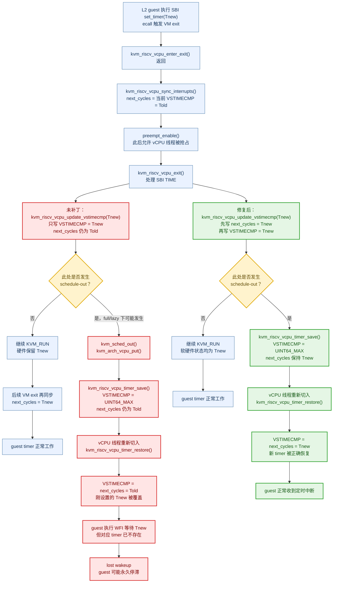

# RISC-V Linux 7.2 nested-TCG 卡死与健康探测超时修复

## 问题概述

RISC-V Linux 7.2 L1 内核运行 nested-TCG L2 microVM 时，存在两个相互独立的问题：

1. 原始启动卡死：L2 vCPU 进入 WFI 后可能永久失去 timer 唤醒，模板创建阶段无法到达 `VsockServerReady`。
2. 后续健康探测失败：L2 服务已经监听并能够正常响应，但 Cubelet 默认的单次 HTTP 请求超时只有 100ms，导致客户端提前断开，模板最终无法 READY。

两个问题需要分别修复。调大健康探测超时不能修复原始 WFI 卡死，修改 preemption 模式也不能替代内核修复。

## 1. VSTIMECMP 软件状态不同步

### 根因

guest 执行 SBI `set_timer(Tnew)` 后，Linux 7.2 的 SSTC 更新路径只写入硬件 `VSTIMECMP`，没有同步更新软件状态 `timer.next_cycles`。

在 SBI exit 处理之前，`kvm_riscv_vcpu_sync_interrupts()` 会先把硬件中的旧值采样到 `next_cycles`。因此，SSTC 更新完成后可能出现：

```text
硬件 VSTIMECMP = Tnew
软件 next_cycles = Told
```

如果 vCPU 在重新进入 guest 前被抢占：

1. `kvm_sched_out()` 触发 vCPU put。
2. `kvm_riscv_vcpu_timer_save()` 禁用硬件 comparator，但软件仍保存 `Told`。
3. 下一次 vCPU load 执行 `kvm_riscv_vcpu_timer_restore()`。
4. restore 使用 `next_cycles=Told` 覆盖硬件中的 `Tnew`。
5. guest 等待的新 deadline 丢失，WFI vCPU 可能永久睡眠。

### SSTC timer 竞态与修复流程图



### 与 preemption 的关系

这不是 SSTC 与 preemption 的功能冲突，而是 preemption 打开了软硬件状态不一致期间的 save/restore 窗口。

`full` 和 `lazy` 都复现过原始 wedge，只是触发概率不同。因此，调整 preemption 模式只能用于 A/B 调试，不能作为修复。

### 修复

在写硬件 `VSTIMECMP` 前同步 `next_cycles`：

```c
static int kvm_riscv_vcpu_update_vstimecmp(struct kvm_vcpu *vcpu, u64 ncycles)
{
	struct kvm_vcpu_timer *t = &vcpu->arch.timer;

	t->next_cycles = ncycles;
#if defined(CONFIG_32BIT)
	ncsr_write(CSR_VSTIMECMP,  ULONG_MAX);
	ncsr_write(CSR_VSTIMECMPH, ncycles >> 32);
	ncsr_write(CSR_VSTIMECMP, (u32)ncycles);
#else
	ncsr_write(CSR_VSTIMECMP, ncycles);
#endif
	return 0;
}
```

该行为与非 SSTC 的 `kvm_riscv_vcpu_update_hrtimer()` 已有实现一致，可确保新 deadline 在 vCPU put/load 后仍然保留。

补丁文件：

- `configs/patches/riscv64-kvm-vstimecmp-next-cycles.patch`

统一构建入口：

- `hypervisor/scripts/build_guest_kernel_riscv64.sh`

以下 workflow 的内核缓存键均已加入该补丁，防止恢复未修复的旧内核：

- `.github/workflows/riscv64-control-plane-demo.yml`
- `.github/workflows/riscv64-snapshot-integration.yml`
- `.github/workflows/release-kernel.yml`

## 2. 单次 HTTP 健康检查请求过早超时

### 根因

模板 READY 的总探测预算与单次 HTTP 请求预算是两个不同配置：

- `TimeoutMs`：整个 readiness 探测的总预算。
- `ProbeTimeoutMs`：每次 HTTP 请求的完整超时，覆盖连接、响应和读取过程。

Cubelet 在未显式设置 `ProbeTimeoutMs` 时使用 100ms。该值被赋给 Go `http.Client.Timeout`，不是单纯的 TCP dial timeout。

在 nested-TCG 环境中，健康服务可能已经正常监听，但一次响应需要数秒。原配置会在 100ms 后主动断开；guest 日志中的 `BrokenPipeError` 与这一客户端行为一致。使用更长单次请求预算的 curl 能在同一 VM 上成功访问该服务，说明服务并非永久无响应。

### 修复

CLI 新增独立参数：

```text
--probe-request-timeout-ms
```

默认值保持 100ms，避免改变其他架构的既有行为。RISC-V TCG replay 显式配置：

```bash
--probe-timeout-ms 300000 \
--probe-request-timeout-ms 30000
```

即总探测预算为 300 秒，每次 HTTP 请求最多等待 30 秒。

相关文件：

- `CubeMaster/cmd/cubemastercli/commands/cubebox/template.go`
- `CubeMaster/cmd/cubemastercli/commands/cubebox/template_test.go`
- `hypervisor/scripts/run_control_plane_riscv64.sh`

单元测试覆盖默认 100ms、自定义 30000ms，并确认总预算仍独立保持为 300000ms。

## 验证结果

### 构建与单元测试

- Go 1.25.7 下 `go test ./cmd/cubemastercli/...` 通过。
- riscv64 `cubemaster` 和 `cubemastercli` 交叉构建通过。
- `tpl create-from-image --help` 已确认包含 `--probe-request-timeout-ms`。
- 三个修改过的 shell 脚本语法检查通过。
- 内核补丁通过正向、反向应用及与已验证源码的一致性检查。

### 最小复现与回归

未补丁内核复现过双核 timer 计数为零，以及一个 vCPU 正常、另一个 vCPU 的 timer compare 停在 `UINT64_MAX` 的情况。

补丁后：

- 双核 timer 120 秒测试：总计 21086 次唤醒，`wake_delays=0`。
- 双核 IRQFD/MSI 120 秒测试：注入与接收均为 44068 次，`wake_delays=0`，guest、injector 和 vCPU 均无错误。

### 完整本地 control-plane 流程

本地完整 replay：`c1-l1-timerfix-probe30s-1`。

结果：

```text
cold_start               21.844s  PASS
create_snapshot          15.663s  PASS
warm_restore             17.558s  PASS
snapshot_preserves_fs    -        PASS
snapshot_preserves_mem   -        PASS
CONTROL_PLANE_DEMO: PASS
```

该验证覆盖模板创建、cold start、`run_code`、snapshot、warm restore，以及文件系统和内存状态保持，不是仅以模板 READY 或 agent-ready 作为通过标准。

完整原始日志保存在 232：

```text
/cube-ci-replay/replay-timerfix-probe30s-1.log
```

## 提交

- `5b5a5539`：VSTIMECMP 内核修复、统一构建接入及缓存键更新。
- `efe4fef5`：独立 HTTP readiness 请求超时及 RISC-V 配置。
- `02d2892f`：preemption 配置说明和 AIA/IMSIC、eventfd/eventpoll 诊断增强。

## 后续验证要求

1. GitHub Actions 必须使用上述提交重新构建 patched 7.2 内核，并完成完整 control-plane demo。
2. CI 日志必须完整保留并原样检查，不能用过滤后的摘要替代主日志。
3. 本地和 CI 通过不能相互替代。
4. 为确认原始 wedge 的修复稳定性，仍需进行未补丁/补丁内核的重复生产 A/B；单轮完整 PASS 不能证明概率性竞态已彻底消除。
